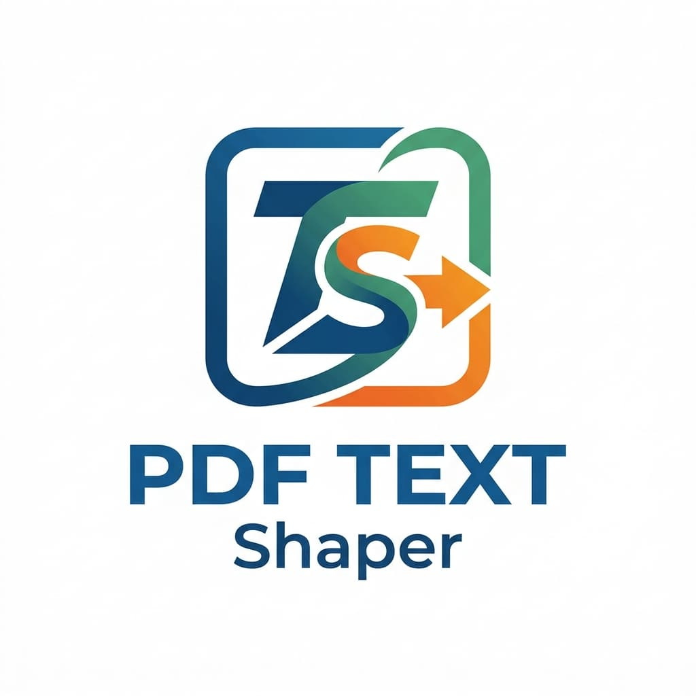

<div align="center">
  <a href="https://github.com/ardevcraft/pdf_text_shaper">
    
  </a>
  <h1>pdf_text_shaper</h1>
</div>
Complex-script text shaping for Dart’s [`pdf`](https://pub.dev/packages/pdf) package, powered by HarfBuzz.

Use `pdf_text_shaper` to render scripts that need contextual glyph shaping, ligatures, or precise mark positioning. It supports Bengali, Devanagari, Tamil, Telugu, Malayalam, Kannada, Gujarati, Gurmukhi, Arabic and Persian, Hebrew, Thai, Khmer, Myanmar, Sinhala, Tibetan, and other scripts supported by HarfBuzz and the font you provide.

## Why

Complex scripts need OpenType shaping. Conjunct substitution, mark positioning, matra reordering, ligatures, and contextual forms depend on GSUB/GPOS data inside the font.

This package:

- shapes Unicode with HarfBuzz;
- renders the shaped glyph outlines into `package:pdf`;
- supports font fallback;
- preserves line breaks and wraps text;
- can add an invisible Unicode layer for PDF search/copy;
- does **not** convert text into legacy ANSI encodings;
- does **not** bundle or redistribute fonts.

## Supported platforms

| Platform | Support |
| --- | --- |
| Android | ✅ |
| iOS | ✅ |
| Linux | ✅ |
| macOS | ✅ |
| Windows | ✅ |
| Web | ❌ currently |

The native backend uses `harfbuzz_ffi`. Web is intentionally not advertised until a WASM/native shaping backend is available.

## Installation

```yaml
dependencies:
  pdf_text_shaper: ^1.1.0
  pdf: ^3.13.0
```

The package requires Dart 3.13 or newer.

## Basic usage

```dart
final bytes = await File('/path/to/NotoSansBengali.ttf').readAsBytes();
final font = ShapedFont.fromBytes(bytes, name: 'Bengali');

final document = pw.Document();

document.addPage(
  pw.Page(
    build: (_) => ShapedText(
      'বিশ্বাস মূলত প্রয়োজন আর আশার দত্তকসন্তান।',
      style: ShapedTextStyle(
        font: font,
        fontSize: 18,
      ),
    ),
  ),
);

final pdfBytes = await document.save();
font.dispose();
```

Use a Unicode OpenType TTF/OTF whose license permits your intended use and whose glyph coverage includes the text you render.

## Mixed scripts and fallback fonts

```dart
final style = ShapedTextStyle(
  font: latinFont,
  fallbackFonts: [
    bengaliFont,
    devanagariFont,
    tamilFont,
    arabicFont,
  ],
  fontSize: 16,
);

final widget = ShapedText(
  'Invoice ১২৩ • हिन्दी • தமிழ் • العربية',
  style: style,
);
```

The renderer selects a font per Unicode run and lets HarfBuzz infer shaping properties.

## Searchable/copyable text

`preserveUnicodeText` defaults to `true`.

The visible text is drawn from shaped glyph outlines. A second invisible Unicode text layer is emitted with the matching source text and font. This is designed to retain useful PDF search/copy semantics while avoiding the visual corruption caused by unshaped PDF text.

```dart
ShapedTextStyle(
  font: font,
  preserveUnicodeText: true,
)
```

Set it to `false` when you only need visual output or when PDF size/text extraction behavior matters more than selection.

## Font diagnostics

```dart
final diagnostics = ShapedFontDiagnostics(font);

print(diagnostics.report('বাংলা'));
```

## Current limitations

- Web is not supported by the native HarfBuzz backend.
- Mixed bidirectional paragraphs use script-run direction handling, not a complete Unicode Bidirectional Algorithm implementation yet. Pure RTL runs work; very complex nested LTR/RTL text should be tested.
- Glyphs are rendered as PDF vector paths. This favors correctness and independence from `pdf`'s text shaper, but can create larger files than native subset-text rendering.
- Color emoji/color-font painting is not implemented.
- Vertical text is not implemented.
- The invisible Unicode layer is a pragmatic text-extraction bridge, not a custom CID/ToUnicode shaper.

## Resource lifetime

`ShapedFont` owns native HarfBuzz resources. Reuse a font for the whole PDF generation session and dispose it after `document.save()`:

```dart
final font = ShapedFont.fromBytes(bytes);
try {
  // build + save PDF
} finally {
  font.dispose();
}
```

## Repository

Explore the source, report issues, or contribute on GitHub:

[github.com/ardevcraft/pdf_text_shaper](https://github.com/ardevcraft/pdf_text_shaper)

If this package is useful to you, please consider starring the repository.

## License

This package is licensed under the [Apache License 2.0](LICENSE). Fonts supplied by your application are governed by their respective licenses.
